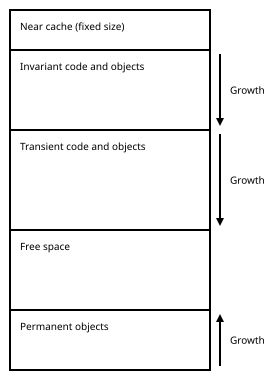

.. _umlarch:

UML Architecture
================

.. contents::
    :local:
    :depth: 2

.. _umlarch-intro:

Introduction
------------

MAME provides a framework to assist in developing recompilers for CPUs,
DSPs and other emulated devices.  A recompiler uses several components:

* The *front-end* analyses the emulated instruction stream and produces
  sequences of instruction descriptions.  Recompiler front-ends derive
  from the ``drc_frontend_base`` class template.
* The *recompiler* translates the instruction descriptions to
  intermediate UML instructions.  The recompiler derives from the
  ``cpu_device`` class for the common cases of emulating CPUs and DSPs.
* The *back-end* translates the UML instructions to a form suitable for
  execution, and provides the means to execute the result.  While the
  front-end and recompiler are specific to the emulated device, the
  back-end is independent of the emulated device but may be specific to
  the host system.

.. _umlarch-cache:

The recompiler cache
--------------------

The recompiler cache is a contiguous area of virtual memory used to
store generated code and associated data.  The desired cache size can be
calling ``set_cache_size``, but the size cannot be changed after
initialisation.  If possible, a cache size large enough to hold a
typical working set for the emulated system should be used.  If the
cache is too small, the transient portion of the cache will need to be
flushed very frequently, and performance will suffer due to the need to
constantly regenerate code.

With the exception of a few UML instructions specifically for loading
and storing data (:ref:`LOAD <umlinst-load>`, :ref:`LOADS
<umlinst-loads>`, :ref:`STORE <umlinst-store>`, :ref:`RESTORE
<umlinst-restore>` and :ref:`SAVE <umlinst-save>`),
generated code can only access data located within the recompiler cache.

The recompiler cache is divided into multiple areas, which are used to
store different kinds of code and data.  The layout of the cache is
illustrated below, with the lowest address at the top and the highest
address at the bottom.

The *near cache* is a fixed-size area (currently 128 KiB) starting at
the lowest address in the cache.  Data close to the start of the near
cache is most efficient to access from generated code.  Recompilers
should store frequently used data in the near cache.

Objects may be allocated in the near cache by calling
``cache_alloc_near``.  This function may also be used to allocate arrays
of objects that are trivially constructible and destructible in the near
cache.

The portion of the recompiler cache immediately following the near
cache is used to store *invariant* data and generated code.  Memory used
for invariant data and generated code cannot be reclaimed for the
lifetime of the recompiler.  For this reason, it should be used for
generated code and associated data that only depends on static
configuration and won’t need to change.  The invariant portion of the
recompiler cache grows toward higher addresses.

Trivially destructible objects may be allocated in invariant portion of
the cache by calling ``cache_alloc_invariant``.  This function may also
be used to allocate arrays of objects that are trivially constructible
and destructible in the invariant portion of cache.  Note that after
allocating any memory in the transient portion of the cache, it is no
longer possible to allocate memory in the invariant portion of the cache
until the transient portion of the cache is cleared (by calling
``reset``).

The invariant portion of the recompiler cache is followed by the portion
used to store *transient* data and generated code.  This area is used to
store translated emulated code and associated data.  The transient
portion of the recompiler cache grows toward higher addresses.  The
transient portion of the cache may be cleared by calling ``reset``.

Trivially destructible objects may be allocated in transient portion of
the cache by calling ``cache_alloc_transient``.  This function may also
be used to allocate arrays of objects that are trivially constructible
and destructible in the transient portion of cache.  Note that all
objects in the transient portion of the cache become invalid after
calling ``reset`` to clear the transient portion of the cache.

The area immediately preceding end of the recompiler cache (highest
addresses in the cache) is used for storing *permanent* objects.  The
permanent object area grows toward lower addresses.

Objects may be allocated in the permanent object area of the cache by
calling ``cache_alloc``.  This function may also be used to allocate
arrays of objects that are trivially constructible and destructible in
the permanent object area of the cache.

Note that destructors **will not be called automatically** for objects
in the recompiler cache.  If you allocate objects in the recompiler
cache that are not trivially destructible (by calling ``cache_alloc``
or ``cache_alloc_near``), you must ensure the destructors are called
before the memory is deallocated or the recompiler cache is destroyed.

As the recompiler cache does not use the default allocator,
``operator delete`` and ``operator delete[]`` **must not** be invoked
for pointers to memory allocated from the cache.  Memory for objects in
the near cache and the permanent object area of the cache may be
deallocated by calling ``cache_dealloc``, passing the pointer and the
size of the allocation as arguments.  The allocation size must be
correct.  There are some limitations on how deallocated memory is
reclaimed.  Memory from large allocations is never reclaimed, adjacent
deallocated areas may not be consolidated, and the permanent object area
never shrinks.  These limitations must be considered if you frequently
deallocate cache memory.

Calling generated code may result in any previously allocated memory in
the invariant and transient portions of the recompiler cache becoming
read-only.  For this reason, the invariant and transient portions of the
cache should only be used to store data that does not need to change
after code generation is complete.  Data that needs to be modified must
be stored in the near cache or the permanent object area of the cache.

Back-ends generally allocate objects in the near cache for storing data
like virtual machine state and tables required on the critical path.
Code handles consume space from the near cache.  Tables for associating
modes and emulated program counter values with generated code are stored
in the permanent object area of the cache.  (See the section on
:ref:`flow control <umlarch-flow>` for more information on these
concepts.)  Back-ends also generate utility code in the invariant and
transient portions of the cache.

.. _umlarch-vm:

The UML virtual machine
-----------------------

UML instructions run on a register-based virtual machine.

The virtual machine has the following architectural registers:

Integer registers
    Ten general-purpose integer registers, named ``I0`` to ``I9``.  Each
    register holds a 64-bit binary value.  Values are interpreted as
    unsigned integers or two’s complement signed integers.  The least
    significant 32 bits are used as input to operations that expect
    32-bit values.  When used as the destination for operations that
    produce 32-bit results, the value is stored in the least significant
    32 bits of the register and the most significant 32 bits of the
    register are cleared (set to zero).
Floating point registers
    Ten general-purpose floating point registers, named ``F0`` to
    ``F9``.  Each register may hold a 32-bit value or a 64-bit value,
    interpreted as IEEE 754 32-bit binary format (single precision) or
    IEEE 754 64-bit binary format (double precision), respectively.
    The result of using a register containing a 32-bit value as an input
    for an operation expecting a 64-bit value or using a register
    containing a 64-bit value as an input for an operation expecting a
    32-bit value is undefined.

    Floating point registers may be used to hold arbitrary binary
    values.  Instructions that copy, load or store data to or from
    floating point registers make no changes to the binary data.
Condition code register
    The condition code register consists of five flags: carry (C),
    overflow (V), zero (Z), sign (S) and unordered (U).

    The condition codes are tested by conditional jump, subroutine
    call/return, C function call, and integer/floating point copy
    instructions (:ref:`JMP <umlinst-jmp>`,
    :ref:`CALLH <umlinst-callh>`, :ref:`EXH <umlinst-exh>`,
    :ref:`RET <umlinst-ret>`, :ref:`CALLC <umlinst-callc>`,
    :ref:`SET <umlinst-set>`, :ref:`MOV <umlinst-mov>` and
    :ref:`FMOV <umlinst-fmov>`).
    :ref:`Sixteen conditions <umlinst-conditions>` are supported.
Exception register
    A special-function register, named ``EXP``, which holds a 32-bit
    binary value.  UML instructions are provided to set the value of
    this register when calling a subroutine (:ref:`EXH <umlinst-exh>`)
    and to retrieve its value (:ref:`GETEXP <umlinst-getexp>`).
Floating point mode register
    A special-function register that controls the rounding mode for
    floating point arithmetic.  Four IEEE 754 rounding modes are
    supported: to nearest (ties to even), toward zero, toward positive
    infinity and toward negative infinity.

The condition code flags have the following definitions:

Carry (C)
    Set to indicate carry out of the most significant bit of an integer
    arithmetic operation, the last bit shifted out for an integer shift
    or rotate operation, or a less than result for floating point
    comparison.  The value is inverted for integer subtraction,
    indicating arithmetic borrow.
Overflow (V)
    Set to indicate two’s complement signed overflow after an integer
    arithmetic operation.
Zero (Z)
    Set to indicate the result of an integer operation is zero, or an
    equal result for a floating point comparison.
Sign (S)
    Set to the value of the most significant bit of the result of
    integer arithmetic, logical and shift operations.  This indicates
    when a two’s complement signed value is negative.
Unordered (U)
    Set to indicate an unordered result for a floating point comparison
    (at least one of the inputs is not a number).

A subroutine call stack is provided, with support for at least sixteen
levels of nested subroutine calls.

Note that the general-purpose integer and floating point registers may
not all have the same performance characteristics.  When this is the
case, the lowest-numbered registers will have the highest performance.
Back-ends may provide some number of “fast” integer and floating point
registers, typically by assigning them directly to host CPU registers.
A recompiler may determine the number of “fast” registers available by
calling ``get_backend_info``.  If, for example, the back-end reports
four “fast” integer registers and six “fast” floating point registers,
the registers ``I0`` to ``I3`` and ``F0`` to ``F5`` are “fast”
registers, and all higher-numbered registers should be expected to have
poorer relative performance.

All register values are undefined on entering generated code, and all
register values are lost when exiting from generated code.  There is no
way to retrieve or set register values from outside generated code.  All
registers besides the condition codes are preserved when calling C
functions or memory access handlers from generated code (the condition
codes are left undefined after calling C functions or memory access
handlers).

.. _umlarch-blocks:

Code blocks
-----------

Recompilers must generate code in *code blocks*.  There are two kinds of
code blocks: *invariant blocks* and *transient blocks*.  Invariant
blocks, created by calling ``begin_invariant_block``, persist for the
lifetime of the recompiler; transient blocks, created by calling
``begin_block``, persist until the next time the transient portion of
the recompiler cache is cleared (by calling ``reset``).  After
generating a transient block or allocating objects in the transient
portion of the recompiler cache, it is not possible to generate
additional invariant blocks until the transient portion of the
recompiler cache is cleared.

Invariant blocks should be used for code that only depends on static
configuration and won’t need to change for the lifetime of the
recompiler (and its associated emulated device).  Transient blocks
should be used for translating emulated code.

Code blocks require explicit entry points to be defined using
:ref:`HANDLE <umlinst-label>` or :ref:`HASH <umlinst-hash>`
instructions, and execution must not be allowed to reach the end of a
code block (a :ref:`HASHJMP <umlinst-hashjmp>`, :ref:`RET <umlinst-ret>`
or :ref:`EXIT <umlinst-exit>` instruction will be used to transfer
control at the end of a block of translated code or subroutine).  See
the section on :ref:`flow control <umlarch-flow>` for more details.

Macros are provided for appending UML instructions to code blocks.  The
recompiler calls ``end`` to indicate that a code block is complete.
This causes the back-end to translate the block to its preferred form
for execution or interpretation in the recompiler cache.  If the free
space in the cache is exhausted, an instance of
``drcuml_block::abort_compilation`` will be thrown.  If this happens
while translating emulated code, the recompiler typically responds by
calling ``reset`` to clear the transient portion of the recompiler cache
and then building the code block again.

The recompiler **must not** delete code blocks.  When the recompiler has
finished building a code block, it must call ``end`` to cause the
back-end to translate the block, or ``abort`` to discard the block.
Calling ``abort`` will result in an instance of
``drcuml_block::abort_compilation`` to be thrown.

.. _umlarch-mapvar:

Map variables
-------------

The ten map variables, named ``M0`` to ``M9``, hold 32-bit binary
values.  At the beginning of a code block, all map variables are set to
zero.  Map variables may be used as source operands where an integer
immediate value is permitted.  If a 64-bit value is expected, the value
of the map variable is extended to 64 bits with zeroes.

The :ref:`MAPVAR <umlinst-mapvar>` instruction is used to assign a new
value to a map variable.  The values of map variables depend on *the
location in the code block*.  An instruction will always see the value
of the map variable set by the nearest preceding :ref:`MAPVAR
<umlinst-mapvar>` instruction in the block (or zero if there is no such
instruction), even if the instruction was reached by jumping forward
over the :ref:`MAPVAR <umlinst-mapvar>` instruction in question, or
jumping backwards to a location following it.

It is also possible to use the :ref:`RECOVER <umlinst-recover>`
instruction from within a subroutine to retrieve the value of a map
variable at the location of the call instruction in the outermost
generated code frame.  This is often used to retrieve the emulated
program counter value when dispatching emulated exceptions.  Note that
this instruction may be very expensive to execute, and it should not be
used in frequently-executed code paths.

.. _umlarch-flow:

UML flow control
----------------

UML instructions provide four kinds of flow control operations:

* Jumping to a label within the same generated code block.
* Calling and returning from subroutines.
* Jumping to the location associated with a mode and emulated program
  counter value.
* Exiting from the generated code and returning to the caller.

The initial entry point to the generated code must also be a subroutine
entry point.

Labels
~~~~~~

Labels are identified using 32-bit unsigned integer values.  Label
numbers must be unique within a generated code block.  Locations are
marked as potential targets for intra-block jumps using the :ref:`LABEL
<umlinst-label>` instruction.  The :ref:`JMP <umlinst-jmp>` instruction
is used to transfer control to the location associated with a label
within the same generated code block.  It is not possible to jump to a
location in a different code block in this way.

Subroutines
~~~~~~~~~~~

Recompilers refer to generated subroutine entry points using *code
handles*, represented by the ``uml::code_handle`` class and allocated
by calling ``handle_alloc``.  Code handles consume space in the near
cache.  The recompiler must not delete code handles, they remain valid
for the lifetime of the recompiler.

A subroutine entry point is created and associated with a code handle
using the :ref:`HANDLE <umlinst-handle>` instruction.  Subroutine entry
points may be created in both invariant and transient blocks.  Handles
associated with function entry points in transient blocks are
automatically reset when the transient portion of the recompiler cache
is cleared.  Note that a code handle that is currently associated with a
subroutine entry point cannot be associated with a different subroutine
entry point.

Subroutines are called using the :ref:`CALLH <umlinst-callh>` and
:ref:`EXH <umlinst-exh>` instructions.  The :ref:`HASHJMP
<umlinst-hashjmp>` instruction will also call a subroutine if no
location is associated with the specified mode and emulated program
pointer value.  The :ref:`RET <umlinst-ret>` instruction returns from a
subroutine.

Subroutines may be called from within the same code block of from a
different code block.  A handle must be allocated before code to call it
is generated.  However, the handle does not need to be associated with a
subroutine entry point until the subroutine call is actually executed.
This allows for creation of mutually recursive subroutines.  Note that
it may be possible to generate more efficient subroutine call code if
the handle is associated with a subroutine entry point before the code
to call it is generated.

Jumping based on a mode and emulated program counter value
~~~~~~~~~~~~~~~~~~~~~~~~~~~~~~~~~~~~~~~~~~~~~~~~~~~~~~~~~~

A location in a transient block is associated with a mode and emulated
program counter value using the :ref:`HASH <umlinst-hash>` instruction.
If the mode and emulated program counter value are already associated
with a location when code for the :ref:`HASH <umlinst-hash>` instruction
is generated, the association will be replaced.  If the transient
portion of the recompiler cache is cleared (by calling ``reset``), all
associations will be cleared. Note that :ref:`HASH <umlinst-hash>`
instructions are not permitted in invariant blocks.

The :ref:`HASHJMP <umlinst-hashjmp>` instruction takes a mode, an
emulated program counter value and a code handle as operands.  The
instruction unwinds the subroutine call stack, and then either jumps to
the location currently associated with the mode and emulated program
counter value, or calls the subroutine associated with the code handle
if no location is currently associated with the mode and emulated
program counter value.

The :ref:`HASHJMP <umlinst-hashjmp>` instruction may jump to a location
within the same code block, or a location within a different code block.
The :ref:`HASHJMP <umlinst-hashjmp>` instruction is permitted in both
persistent and transient blocks.

Exiting from generated code
~~~~~~~~~~~~~~~~~~~~~~~~~~~

The :ref:`EXIT <umlinst-exit>` exits from the generated code, returning
control to the caller.  It may be used from within any level of nested
subroutine calls in the generated code.  The call stack is automatically
unwound.
